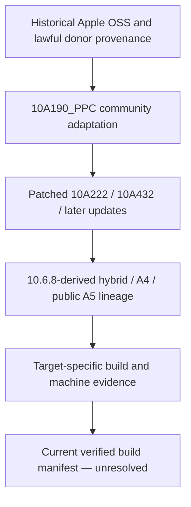

# Owner architecture context — PowerPC Darwin 10 / SLPPC

**Scope:** `Christopher-Charman/apple.powerpc.darwin10` · **Survey window:** 2026-04-19 to 2026-10-19 · **Classification:** private engineering reference, not a live build certificate.

## Place in the portfolio

This repository is the **PowerPC Darwin 10 / Snow Leopard reconstruction source and technical-history owner**. It is not the hosting or web-application repository of the similarly named `powerpc-darwin.org` service. The hosting system, OpenWebUI, model inference, CONTROL and Concurrency Ledger have separate repository/runtime owners. Reuse is intentional; ownership is not interchangeable.

## Essential historical distinctions

- **Stock Apple 10A190 is not the community `10A190_PPC` build.** The latter combines development-preview source with PPC donor KEXTs, BootX/installer adaptations and further modifications.
- Historical work reached **boot-to-Aqua on selected G4 machines** with patched 10A222, subsequent 10A432 GM Aqua recovery, selective 10B504 changes and a **public 10.6.8 Alpha 5 restore on 2025-01-30**. Do not misdate these achievements as new work in April–October 2026 or describe all historical builds as pre-LoginWindow.
- Alpha-5-associated logs show Darwin 10.8.0 / `root:xnu-1504.15.3~1/RELEASE_PPC` on PowerPC, with remaining Finder, DiskImages, authorization/SecurityAgent, directory-service, ATS, Bluetooth, Spotlight and networking defects. A log does not independently identify every media image or hardware configuration.
- Distinguish original community methodology and `@ChrisCharman`'s BUILD.zip / 150+ source projects from later Educovas shims, images, modifications and validation. Attribute the distinct contribution stages separately.

## What changed within this six-month reporting window

Reconstructed 2026 engineering focused on Apple-source genealogy, target/ABI and PPC symbol reconciliation, comparison of 10A190/10A222/10A432/10C540 and 10.6.8 components, preservation of logs and attachment provenance, and historical correction. The **June 2026 Security/TLS investigation** is bounded porting research: Leopard Security patches are references; an x86_64 TLS 1.2 POC is **not** a working PPC port. Source-level Security generation rebinding, PPC ABI/big-endian crypto testing and Keychain/Authorization/WebKit regressions remain necessary.

## Evidence and acceptance

- Canonical project evidence: ChatGPT user Library `/Project Workspaces/powerpc.apple.darwin/` — particularly `SLPPC_10_6_8_POWERPC_TECHNICAL_PROGRESSION_CHRONOLOGY_V3_2026-09-05.md`, `10A222_EVIDENCE_RECONCILED_BACKLOG.md`, `10.6.8_A5_EVIDENCE_RECONCILED_BACKLOG.md`, `SLPPC_JUNE_2026_SECURITY_TLS_PORTING_CONTRACT.md` and `PROJECT_MANIFEST.json`.
- Last cited project-manifest state (2026-09-29): `ACTIVE_RESEARCH_ENGINEERING_BUILD_STATE_UNRESOLVED`; `current_build_manifest=NOT_ESTABLISHED`. This does **not** negate the historical public Alpha 5 release.
- Acceptance for a **current** build needs exact source/tag and component hashes, machine model, firmware/bootloader, target image, boot/log/GUI/network checks and independently reproducible evidence. A source commit, private archive or historical screenshot is not this acceptance.
- Preserve original archives, license/notice and contributor provenance. Never commit personal history exports, secrets or unauthorized Apple/third-party binaries.

## Integration boundary

`repository-prime` owns shared governance and project routing; this repository owns PowerPC Darwin source and its build evidence. The `powerpc-darwin.org` service is a **different** Fasthosts-managed application runtime; similar naming confers no operational or credential authority. Project build experiments do not silently configure production web services.

**Maintenance rule:** revise historical claims from primary logs/manifests and owner evidence; date mutable state; separate `HISTORICAL`, `SOURCE_TESTED`, `LIVE_VERIFIED_AS_OF` and `UNRESOLVED`. This is documentation, not a release/deployment operation.
